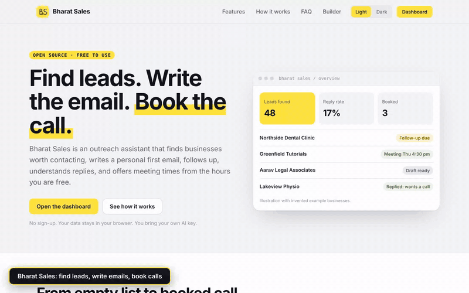
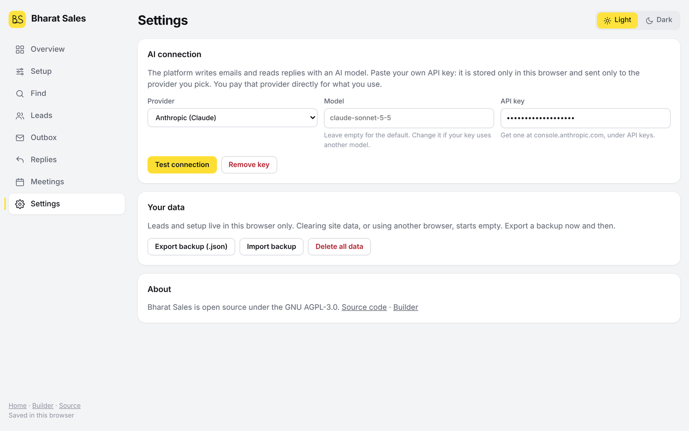
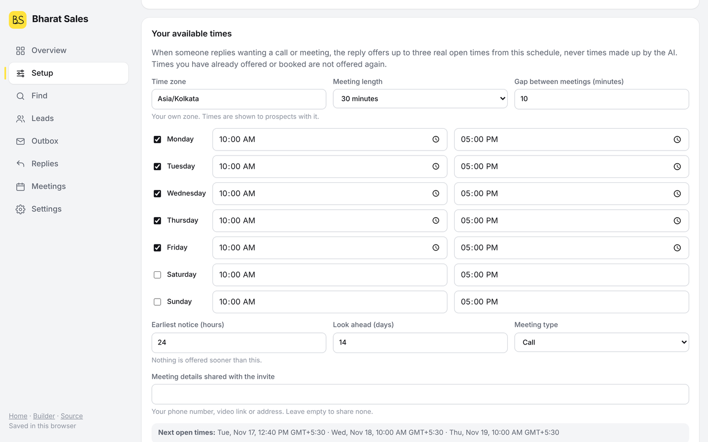
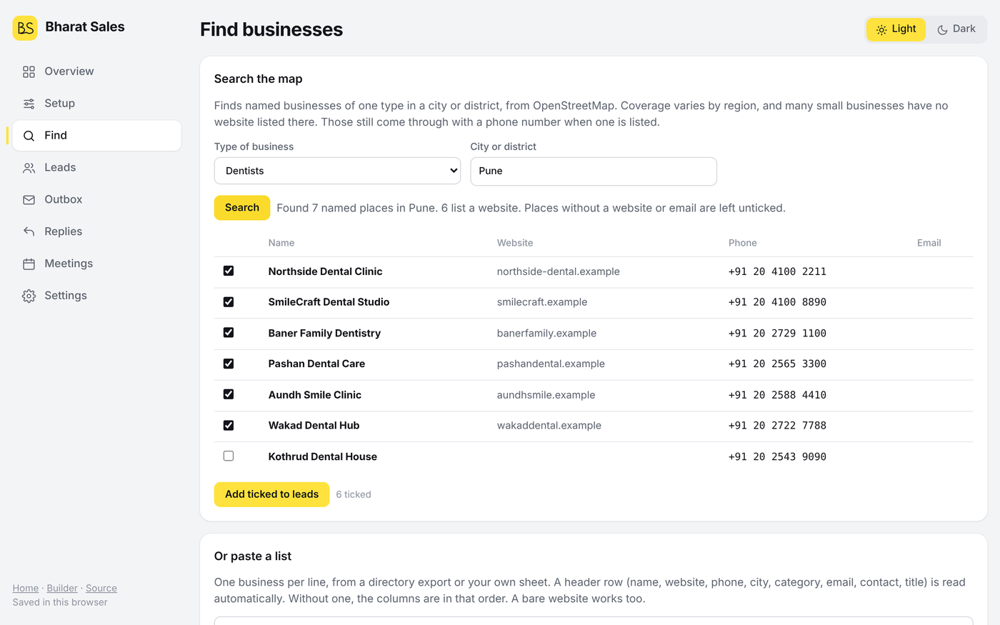
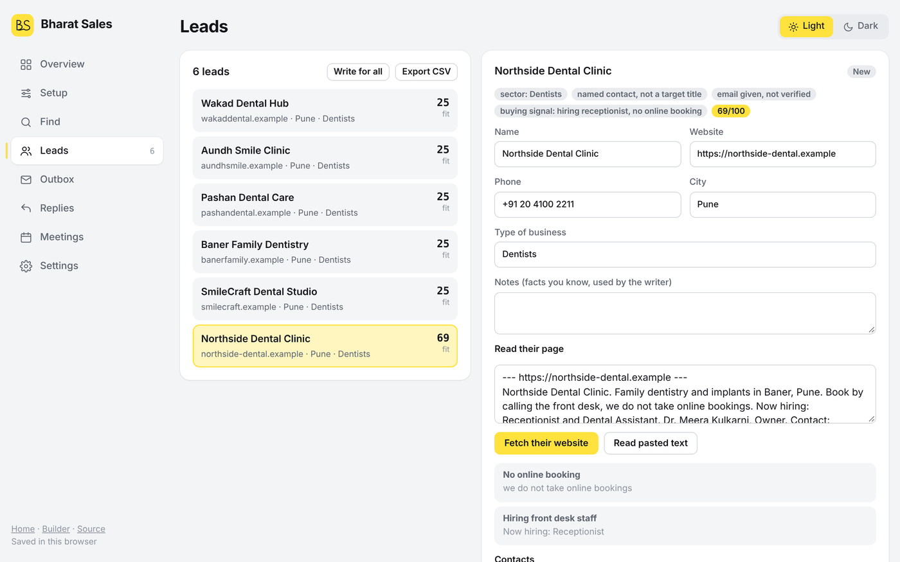
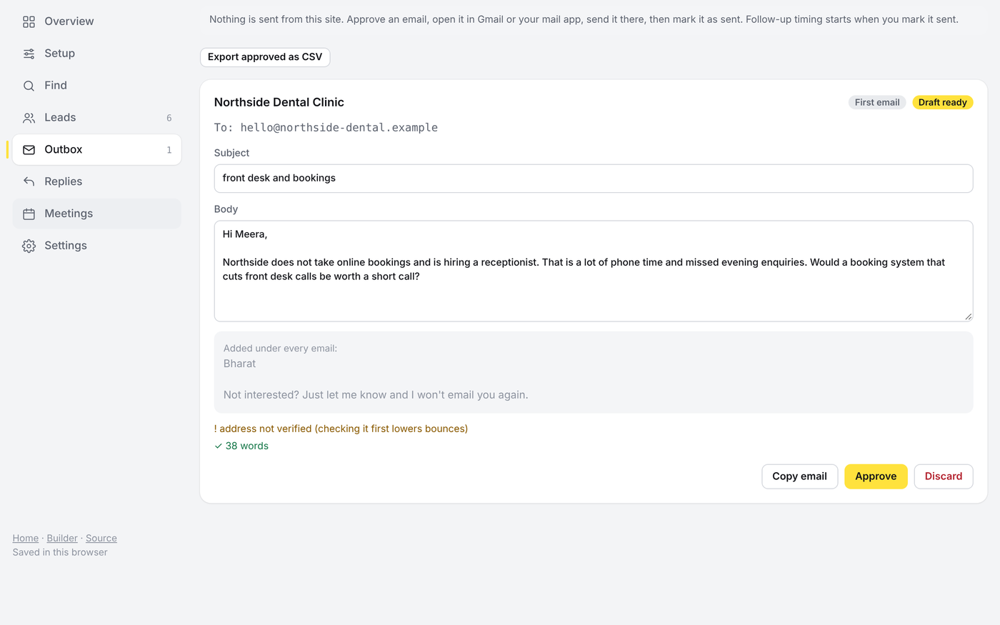
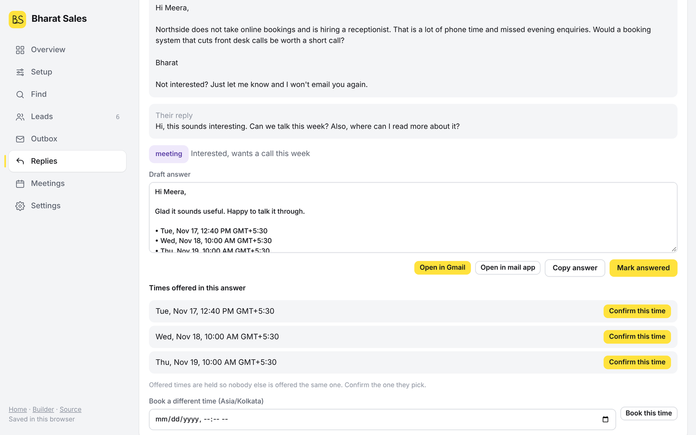
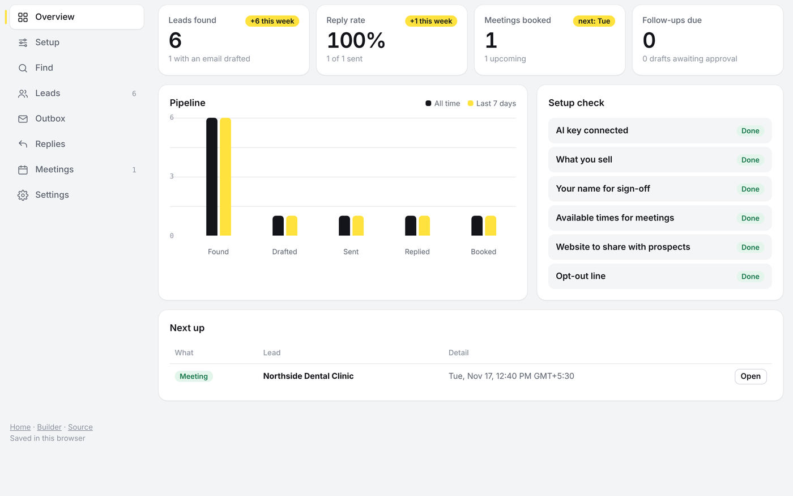
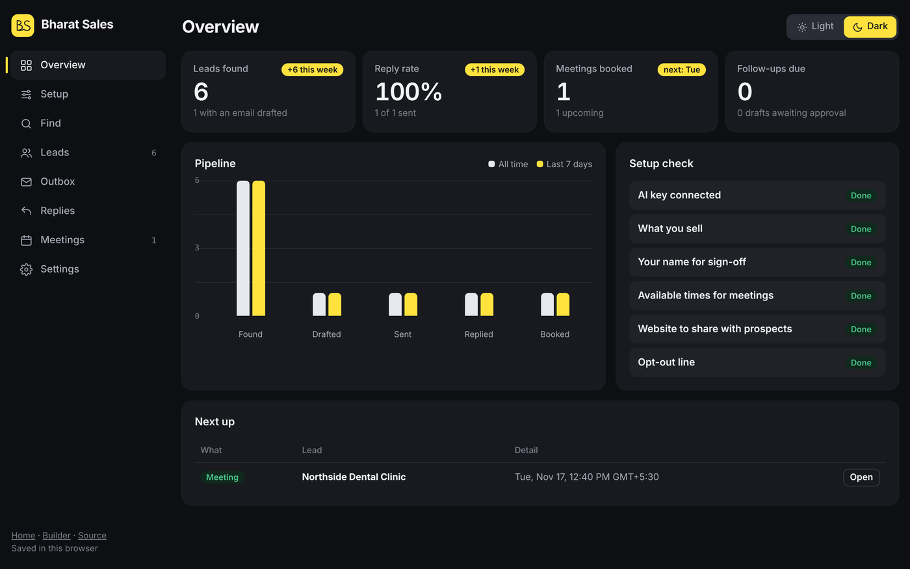

<div align="center">


# Bharat Sales

**Find businesses. Write the email. Book the call.**

An open-source outreach assistant that runs entirely in your browser. It finds businesses worth contacting, reads their websites, writes a personal first email, follows up, understands replies, and offers meeting times from the hours you are free.




<sub>A one-minute walkthrough. <a href="docs/demo.mp4">Watch the full-quality video (MP4)</a>. The businesses and replies shown are invented for the demo.</sub>

</div>

---

## Contents

- [What it does](#what-it-does)
- [See it working](#see-it-working)
- [Quick start](#quick-start)
- [Using the dashboard](#using-the-dashboard)
- [How scheduling works](#how-scheduling-works)
- [Safety checks](#safety-checks)
- [AI providers](#ai-providers)
- [Privacy and your data](#privacy-and-your-data)
- [Deploy your own copy](#deploy-your-own-copy)
- [Project structure](#project-structure)
- [Good to know](#good-to-know)
- [License](#license)

## What it does

Outreach usually means five tools and a lot of copy and paste. Bharat Sales puts the whole loop in one place:

| Step | What happens |
| --- | --- |
| **Find** | Search a city or district on the map for one type of business, or paste your own list. Directory sites, job boards and duplicates are dropped automatically. |
| **Read** | Fetches the homepage, contact and about pages. Emails and phone numbers are lifted by rule. The AI notes what the business does and what they might need, and names are kept only if they appear in the page text. |
| **Score** | Every lead gets a fit score from sector, decision-maker, contact quality and buying signals, so you start with the best ones. |
| **Write** | A short, plain first email that points to something real on their site. If there is nothing true to say, it writes nothing instead of a generic email. |
| **Follow up** | If nobody replies, the next nudge is drafted when it is due, using gaps you set. A reply or an opt-out stops the sequence. |
| **Reply** | Paste what they wrote. It is sorted into interested, wants a call, question, objection, not now, opt-out or auto-reply, and an answer is drafted for you. |
| **Book** | You enter your free hours once. When someone wants to talk, the answer offers real open times and your website. Confirm one and download a calendar file. |

Nothing is sent behind your back. Approved emails open in Gmail or your mail app, fully written, and you press send.

## See it working

### 1. Connect your AI

Paste your own key. It is stored in your browser and sent only to the provider you choose.



### 2. Tell it when you are free

Switch on the days you take calls and set your hours, time zone, call length and the gap between meetings.



### 3. Find businesses

Pick a type of business and a place. Tick the ones you want and add them to your leads.



### 4. Read, score and write

Open a lead to fetch its website. Findings and a fit score appear, and the first email is written from facts on the page.



### 5. Review before anything goes out

Each draft shows its checks: opt-out line, word count, unfilled placeholders and unverified addresses. Approve it, then open it in Gmail or your mail app.



### 6. Handle the reply and book the call

Paste the reply. The answer comes back with three real open times from your schedule and a link to your website. Confirm the time they pick.



### 7. Watch the pipeline

Found, drafted, sent, replied and booked, with the last seven days highlighted. Light by default, dark with one click.

| Light | Dark |
| --- | --- |
|  |  |

## Quick start

**Use a deployed copy**

1. Open the site and press **Dashboard**.
2. Go to **Settings**, choose a provider, paste your key and press **Test connection**.
3. Go to **Setup** and describe what you sell, your website and your free hours.
4. Go to **Find**, search a place, and add the businesses you like.

**Run it on your computer**

```bash
npx vercel dev
```

This serves the pages and the small fetch function together at `http://localhost:3000`. Any static file server also works for everything except automatic website fetching, which then falls back to pasting the page text.

## Using the dashboard

| Tab | Use it to |
| --- | --- |
| **Overview** | See the pipeline, what needs attention next, and a setup checklist. |
| **Setup** | Describe your business, your free hours, who a good prospect is, follow-up timing, the opt-out line and a do-not-contact list. You can paste a short description and have the form filled for you. |
| **Find** | Search the map, paste a list, or get search ideas for your market. |
| **Leads** | Review scores, contacts and findings, fetch a site, and write or skip each lead. Export everything to CSV. |
| **Outbox** | Approve drafts, open them in Gmail or your mail app, mark them sent, and handle follow-ups that are due. |
| **Replies** | Paste a reply, review the drafted answer, and confirm a time. |
| **Meetings** | See booked calls, copy the confirmation, and download a calendar file. |
| **Settings** | Connect your AI key, export or import a backup, or delete all data. |

## How scheduling works

You never type times into emails. The platform works them out from your setup:

- **Your hours:** days you are free, start and end time, time zone, call length and the gap between calls.
- **Notice and horizon:** nothing is offered sooner than your minimum notice or further out than your look-ahead window.
- **One option per day:** offered times are spread over different days so people have a real choice.
- **No double booking:** a time offered to one lead is held, so another lead is not offered the same slot.
- **They suggest their own time:** it is quoted back to you to check against your calendar. You can book any other time by hand.
- **Confirmation:** booking writes the confirmation message and a calendar file (.ics) with your call details.

The AI writes the wording around the times, but it never writes the times themselves.

## Safety checks

Every email passes a pre-send check before the **Approve** button unlocks:

- the opt-out line is present
- the length is within your word limit
- no unfilled placeholders and no banned phrases
- guessed addresses are flagged, and a do-not-contact list is respected

Opt-outs and auto-replies are recognised by rule before the AI reads anything, and an opt-out is never written to again. A reply that mentions legal action gets no draft and is left for you.

## AI providers

Bring your own key. You pay your provider directly for what you use.

| Provider | Where to get a key |
| --- | --- |
| Anthropic | console.anthropic.com, under API keys |
| OpenAI | platform.openai.com, under API keys |
| Google Gemini | aistudio.google.com, under Get API key |
| OpenRouter | openrouter.ai, under Keys |

Leave the model field empty for the default, or enter another model name your key can use. Use **Test connection** to check it.

## Privacy and your data

- There are no accounts and no database. Leads and settings are stored in your browser only.
- Your AI key goes from your browser straight to the provider you choose. It never passes through this site.
- The only server code is one small function, `/api/fetch`, that downloads a public web page for you. It refuses private and internal network addresses.
- Clearing site data or switching browsers starts you empty. Use **Settings → Export backup** to move your data.

## Deploy your own copy

1. Edit `assets/js/config.js` and set `SOURCE_URL` to your repository's address. The license asks that visitors can get the source of the running site.
2. Create an empty repository on GitHub, then in this folder:
   ```bash
   git init
   git add .
   git commit -m "Bharat Sales"
   git branch -M main
   git remote add origin https://github.com/YOUR-NAME/YOUR-REPO.git
   git push -u origin main
   ```
3. On vercel.com choose **Add New → Project** and import the repository.
4. Set **Framework Preset** to **Other**. Leave Build Command and Output Directory empty. Press **Deploy**.

Vercel gives you the live address. Visitors land on the home page in the light theme and can switch to dark with the toggle.

## Project structure

```
index.html            Home page
builder.html          About the builder
dashboard.html        The tool
api/fetch.js          Fetches one public web page (blocks private addresses)
api/_page.js          Turns HTML into text, emails and phone numbers
assets/js/app.js      Dashboard logic
assets/js/theme.js    Light and dark theme, light by default
assets/js/config.js   Your source link
assets/css/           Styles
docs/                 Screenshots and demo video
vercel.json           Clean URLs and basic headers
```

There is no build step and no dependencies to install.

## Good to know

- **Email addresses are not verified.** Keep volume modest and honour opt-outs.
- **Map coverage varies by region.** Many small businesses list no website. They still come through with a phone number when one is listed.
- **The map search uses public services** with fair-use limits. If a search fails, wait a moment and try again.
- **You decide who to contact.** Follow the rules that apply to commercial email where you and your recipients are.
- **Data is per browser.** Export a backup now and then.

## License

Released under the **GNU Affero General Public License v3.0**. See [`LICENSE`](LICENSE) and [`NOTICE`](NOTICE).

## Builder

Built by **Bharat Wagh**, a Computer Engineering student in Pune, open to freelance work.
[LinkedIn](https://www.linkedin.com/in/bharat-wagh-96b3082a8) · [GitHub](https://github.com/Bharat2456) · [Instagram](https://instagram.com/doppelganger.bharat) · [X](https://x.com/BharatWagh1010)
